# Screen wireframes

Layout sketches for the screens of a run, drawn for a 1920×1080 screen with
the party's base at the bottom and the enemy at the top
(`../specs/03-combat.md` CB-45 to CB-48). They show what is on each screen
and where. Sizes, numbers, and building names are placeholders, and the
sketches show a solo view with co-op elements marked.

Specific numbers and example effects in the sketches — gold amounts, the
starting kit, threat pips, "an even chance to double it", "overload begins
4:00", player and ghost names — are placeholders, not rules.

The specs are the source of truth. Where a wireframe and a spec disagree,
the spec wins and the wireframe should be corrected.

The sketches follow the per-player design (issue #124): each player has their
own plot and Core, builds only there, and can link to a neighbour across the
plot border; there is no giving. The images are exported from `screens.html`
and match it.

Some sketches are drawn ahead of the code, and the web proof of concept
differs from them in places:

- It has no lobby, Join or Settings: the menu starts a solo run (a party of
  2 to 4 is played from one device with `#/?players=N`), and adds "Play the
  tutorial" and a short "How a round works".
- Shop and Build are one screen: the shop opens as a panel over the board.
  The stash is called the "Inventory", and a building is sold by selecting it
  and pressing Sell.
- The battle summary is a result card over the board at the end of playback.
- The screens call a PvE battle a "Stronghold" battle and a PvP battle a
  "Rival party" battle; a phase stepper (Set up, Build, Fight, Reward) shows
  where the round is.
- The Sound settings panel (5c, issue #446) is planned, not built.
- The Caravan draft (2b), the four new buildings (4b, issue #437) and the specialist pick (5b, issue #468) are
  planned, not built.

Order in a run: 5 main menu → 5b specialist pick → 6 Core placement → 4 build → then each round:
7 PvE choice → 1 battle → 8 summary → 2 event (and 2b to 2d, if the event has a follow-up) → 3 shop + 4 build → PvP
battle (1, 8) → 2 event → 3 shop + 4 build → … → 9 run over.

- `screens.html` — all the wireframes on one page, with the callouts. Open
  it in a browser. The screens are drawn by a script in the page, so edit
  that script to change them, then re-export the images.
- `1-battle.png` to `9-run-over.png` — the same screens as images, plus `1b-battle-boss.png` (the boss marks) and `1c-battle-points.png` (points of interest), both after the Battle screen and `2b-caravan.png`, `2c-rich-vein.png` and `2d-blueprint.png` (the event follow-ups, after the Event choice screen), and `4b-build-footprints.png` (placement previews for the four new buildings, after the Build screen) and `5b-specialist-pick.png` (the specialist pick, after the Main menu) and `5c-sound-settings.png` (the Sound settings panel, issue #446, planned, after the specialist pick).

Not drawn: the lobby for forming a party and settings other than sound. Points of interest are
drawn in 1c and on the Battle summary (issue #370). Refining (issue #378) is drawn on the
Shop, Build and Battle screens.

Map legend: **Ex** extractor, **Bk** barracks, **Fo** foundry, **Tu** turret,
**Sp** splitter, **Ar** armory (an economy building), **Rc** Composite refinery
(Ore + Power), **Ra** Aether refinery (Power + Flux), **Gf** Golem forge, **Sr**
Spire, **Lh** Lancer hall, **Gb** Grand barracks, **Mo** Mortar, **Mg** Merger, **Tn** Tunnel ends, solid blocks are
walls, and **O / P / F** diamonds are Ore, Power, and Flux nodes. Conduits
are coloured by resource.

## 1. Battle

Nobody gives orders here. The party watches its factory start cold, ramp up, and send units across the neutral zone while the enemy does the same. Each player has their own Core, so each side shows one health bar per Core under a total. The image is a three-player party against a PvE stronghold, with one of the party's Cores fallen; a solo battle shows one bar per side, with no total above it.

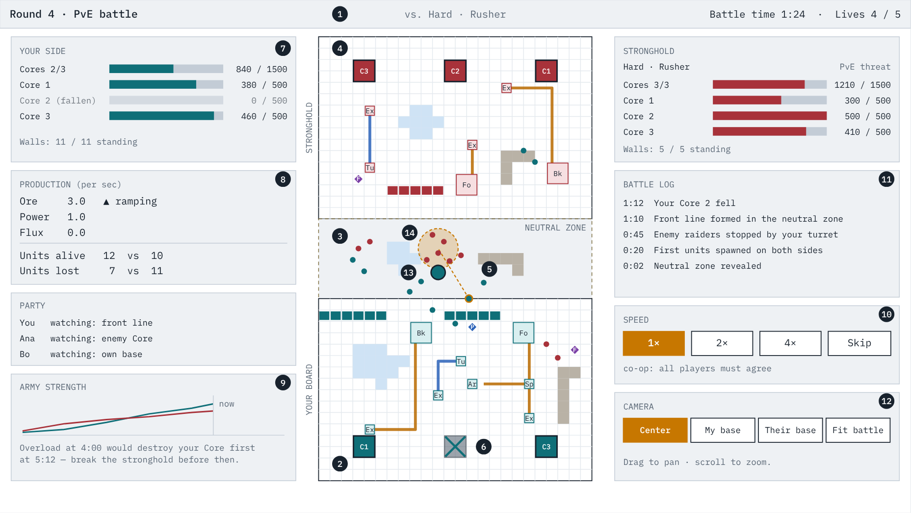

1. Who you are fighting and what kind of battle it is. A ghost shows the other party's names and each player's specialist (MM-11a); a boss says so and names the boss. The marks a boss adds are in 1b below.
2. Your board, at the bottom, exactly as you built it. Conduits light up as resources flow.
3. The neutral zone. Its lakes and cliffs are generated for this battle and revealed when it starts. Nothing can be built here. Turrets can shoot enemy units in it; otherwise only units fight here.
4. The enemy board, at the top, with one Core per player. Your units attack buildings in their way and finally the enemy Cores: first the one opposite their owner's plot, then the nearest still standing.
5. Units from both sides meet and form a front line.
6. A Core that has fallen: greyed out with a cross in its side's colour. Its player's buildings stay on the board.
7. The total Core health and how many Cores stand ("Cores 2/3"), then one bar per player's Core ("Core 2 (fallen)" once it is destroyed), and how many walls still stand. The enemy's are in the matching panel on the right. A side loses when all of its Cores are destroyed. With a single Core the panel shows one bar, as in a solo battle.
8. Live production and army counts, so you can see the ramp.
9. Army strength over time for both sides. Against a PvE stronghold the Overload line below it says which side's last Core Overload would destroy first, and when ("Overload at 4:00 would destroy your Core first at 5:12"). There is no such line against a ghost.
10. Speed controls. In co-op, a change applies once everyone agrees.
11. A log of the moments that mattered, such as a junction being destroyed or a Core falling ("Your Core 2 fell"; with a single Core, "Your Core destroyed").
12. Camera presets: Center, My base, Their base and Fit battle. It starts at the center of the map, and the view pans and zooms, so a larger map or a four-player battle still works on the same screen.
13. A Golem leads the push. It is drawn bigger than other units: huge health and flat armor, but slow and weak in attack.
14. A caster's blast hits a group: units near the target take part of the hit (area damage). Units only, no buildings, no friendly fire.

## 1b. Battle: boss marks

A boss battle looks like screen 1 plus one extra mark for the boss in play (MM-9d). Each boss changes only its own side, never the party's factory (MM-9a). The image shows all four marks together; a real battle shows only one. Names are placeholders.

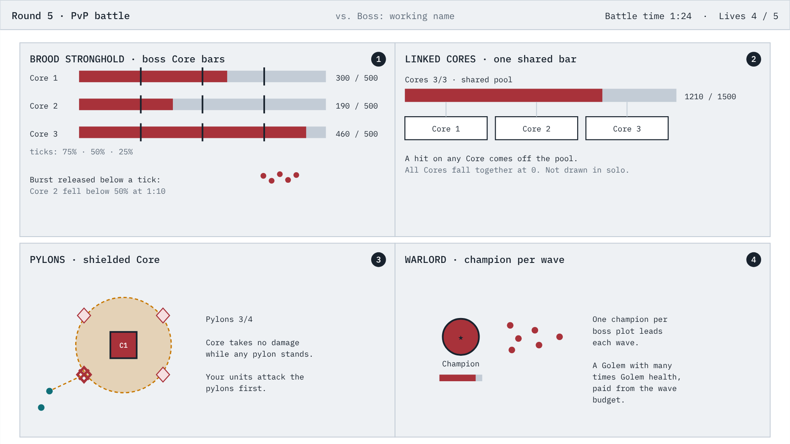

1. Brood stronghold: ticks at 75%, 50% and 25% on each boss Core bar. Below a tick the Core releases a burst of units, and the log says so.
2. Linked Cores: one shared bar for all boss Cores, with the Cores listed under it. Damage to any Core comes off the bar, and they all fall together. Not used in solo.
3. Pylons: shield pylons around a boss Core, a shield ring while any stands, and a count ("Pylons 3/4"). Your units go for the pylons first.
4. Warlord: the champion leading each wave, drawn bigger than a Golem, with its own health bar.

## 1c. Battle: points of interest

The neutral zone of a four-player battle, drawn flat, with one point in each plot band (CB-8c to CB-8g). A real battle shows the zone between the two boards as on screen 1. The image shows four moments at once; names and numbers are placeholders.

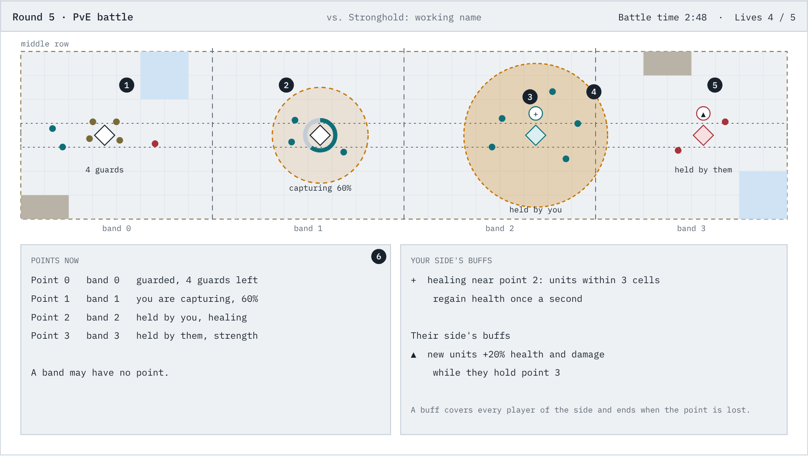

1. A guarded point: neutral guards hold it and fight units of both sides that come near. Nothing can be captured while a guard lives.
2. A point being captured: your units keep to its capture range, and the ring in your colour fills as they hold it. Both sides in range means no progress.
3. A held point: a solid marker in the holder's colour with its buff icon. A buff applies to every player of the side (CB-8c).
4. The healing area: the holder's units inside it slowly regain health.
5. A point held by the enemy, with the strength icon: their new units are stronger while they hold it. Your units that pass near it divert to retake it.
6. The buffs your side has now, and what each point is doing. A band may have no point.

## 2. Event choice

After every battle the party picks one of up to three events. It opens with the battle result so the reward is seen before the next decision.

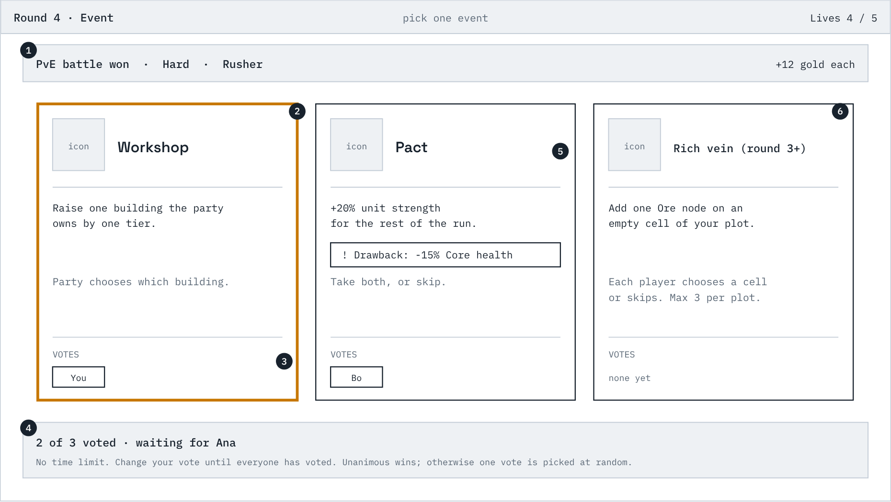

1. Result of the battle just fought and what it paid.
2. Up to three offered events (never two of the same type). Each says exactly what it does before you choose.
3. Votes from each player. The highlighted card is your own vote; you can change it until the last player has voted.
4. Who has voted and how a split vote is settled (one vote is picked at random). There is no time limit; the event resolves once everyone has voted.
5. A drawback has its own marked line, shown before the vote (RS-4f). It is opt-in: take both or skip, and skipping never harms the party (a Pact).
6. An offer names what it needs up front, such as the resource of a Rich vein, and may show the first round it appears from (RS-4g).

## 2b. Caravan draft

A Caravan is a draft, not a vote (CP-16). It lists one more reward than there are players. Players choose one each, in turn; each reward is taken once and the last one is left. The order rotates from one Caravan to the next (RS-4h). Rewards are placeholders.

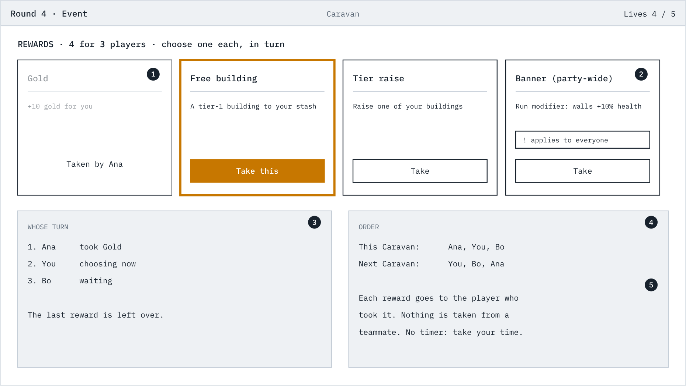

1. The reward list: players + 1 rewards. A taken reward shows who took it.
2. The party-wide reward (at most one) is marked and says it applies to everyone.
3. Whose turn it is. You choose only when it is your turn.
4. The order for this Caravan, and for the next.
5. Rewards go to the player who took them. Nothing comes from a teammate (CP-29).

## 2c. Rich vein

Each player may add one node of the named resource on an empty cell of their own plot, or skip (RS-4i4). The type is random and is stated on the offer before the vote.

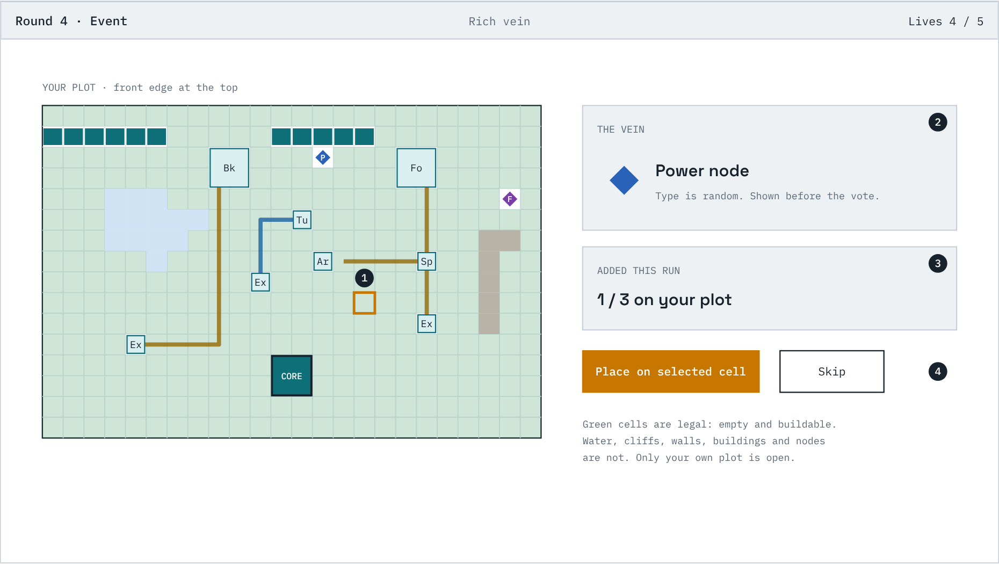

1. Your own plot. The green cells are the legal ones: empty, buildable cells.
2. The resource type for this vein, named before the vote.
3. Nodes added so far this run: at most 3 per plot.
4. Skip. Skipping costs nothing.

## 2d. Blueprint

Each player chooses one of three rare buildings eligible at this round (RS-4i5). It is not free: it waits in the next shop.

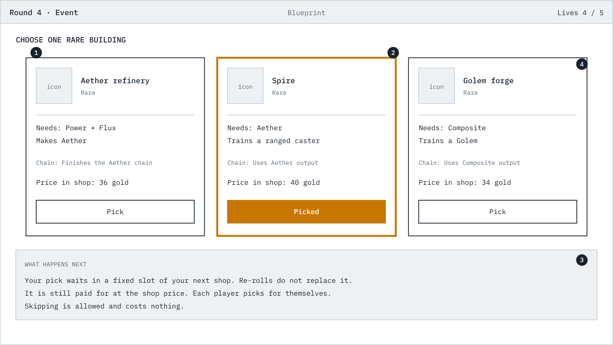

1. Three rare buildings. Each card shows what it needs and what it does, as in the shop.
2. Your pick. Each player picks for themselves.
3. The note: the building is held in a fixed slot of your next shop that re-rolls do not replace, and it is still paid for.
4. The refining chain it helps finish, named on the card.

## 3. Shop

The shop always follows the event. Each player has their own offers and their own gold. Shop and Build are two tabs of the same step, so you can buy, place, and come back. Nothing is timed: the party moves on when every player has pressed Ready.

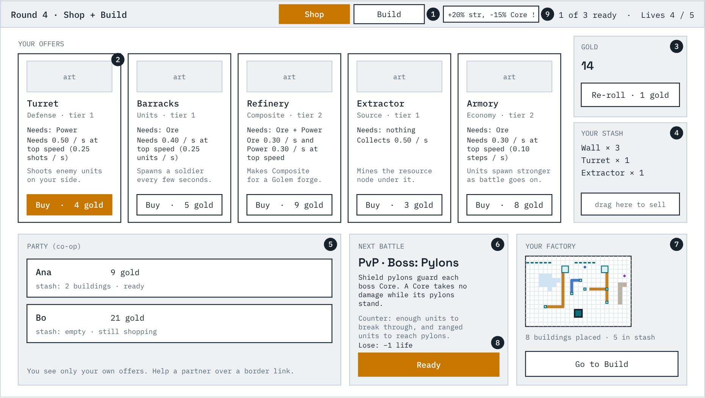

1. Tabs for the two halves of this step.
2. Your offers, bought for your own plot. A card shows the kind, what it needs (which resource), its rate per second (a consumer's need at top speed, an extractor's collect rate), what it does, and its price. A refinery card shows its two inputs and what it makes.
3. Gold buys buildings and re-rolls, nothing else.
4. Your stash: buildings you own that are not on the board. Drag here to sell.
5. Teammates' gold and stash. You do not see their offers, and gold and buildings cannot be given (CP-29). Hidden in solo.
6. What comes next. PvE options are shown ahead of time. A ghost opponent never is. When the opponent is a boss, the panel names the boss, gives one line on its mechanic and one line of counter advice, so you can build against it (MM-11). The image shows a boss; names are placeholders.
7. A small live view of the board that jumps to the Build tab.
8. Ready is available on both tabs.
9. Held run modifiers: a small chip in the run bar, effects totalled, drawbacks marked with "!" (RS-4j). It is on every run screen; it is drawn on this one only.
10. Your specialist, a chip in the run bar. It is on every run screen after the pick, and drawn here, on Build and on Core placement (RS-13).
11. A signature building (the Mana Well in the sketch) is offered only in its specialist's own shop and is marked "Signature" (EC-3b). A partner's shop never has it.

## 4. Build

Where the factory is laid out. Everything of yours except your Core can be moved, and conduits are free. In co-op every player edits at the same time, each in their own plot; the other plots are shown but cannot be edited. The image shows your own plot with its border links, owner tags and a LOW marker.

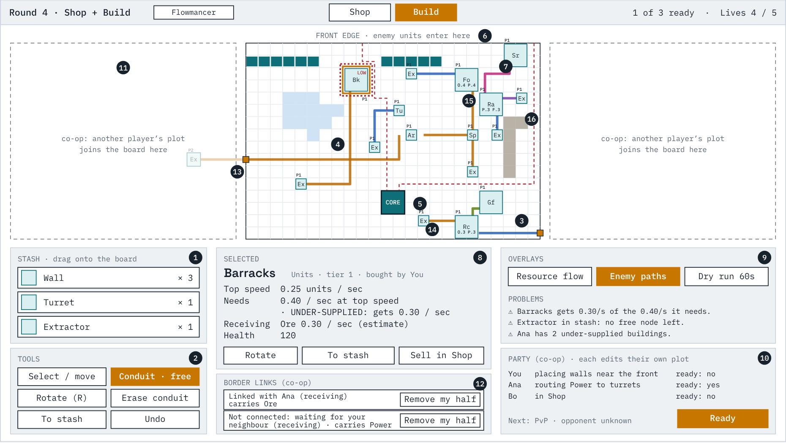

1. Stash. Drag a building into your own plot to place it; placing is free.
2. Tools. Conduit is always available and unlimited. Rotate turns the selected building. Undo covers layout changes only, never buying, selling, or re-rolling.
3. The board. Lakes and cliffs cannot be built on. Extractors only go on resource nodes.
4. Conduits, one resource each, coloured by resource. They cannot cross; the splitter is what lets one line feed two buildings. A conduit drawn to the border of a neighbour's plot joins the neighbour's conduit at the same spot into a border link; either player can remove their own half.
5. Your Core. Placed once at the start of the run; it has no move handle. Every player has one.
6. The front edge, along the top. Enemy units enter along it.
7. Preview of the routes enemy units would take with this layout, each to the Core of the plot it enters.
8. Inspector for the selected building: what it needs per second, what it is getting, what it produces. For a collector: its flow rate.
9. Overlays and problems: a dry run of resource flow, the enemy-path preview, and anything unconnected.
   Your own buildings are listed one by one, and each partner gets one summary line (for example "Ana has 2 under-supplied buildings."). The dry-run table shows each consumer's need per second and "supplied" or "UNDER-SUPPLIED" (all inputs together).
10. Party panel: who is editing where, pings, and the Ready button. The party moves on when everyone is ready.
11. In co-op each extra player adds a plot of their own to the side. A four-player board still fits the width of a 1080p screen, and everything below the board stays free for panels.
12. Border links (co-op): a list of your own halves, each with its state (linked, waiting for your neighbour, or cannot join), what it carries, and a Remove my half button.
13. A border spot on the plot edge, where your conduit meets the neighbour's. The neighbour's half is drawn dimmed beside it. Buildings carry their owner's tag (P1, P2), and a consumer that gets less than it needs is marked LOW.
14. A Composite chain: an Ore conduit and a Power conduit come into the refinery (Rc) from two sides, and a Composite conduit, in its own colour, goes to the Golem forge (Gf). The Power here comes over a border link. The small text on each two-input building (Foundry, both refineries) is its need per second for each input (O = Ore, P = Power, F = Flux).
15. An Aether chain: Power and Flux go into the refinery (Ra), and an Aether conduit, in its own colour, goes to the Spire (Sr).
16. The one Flux node feeds this chain. An Overclocker would also want it, so running both means sharing Flux over a border link.

## 4b. Build: new footprints

Four planned base buildings (CB-9f, issue #437), with working names. Their shapes make the layout a real decision: a 1×3, a 3×3, a two-piece Tunnel and a turret with a blind spot. The image shows four placement previews on the Build screen. As always, each helps only its owner and goes only in its owner's plot.

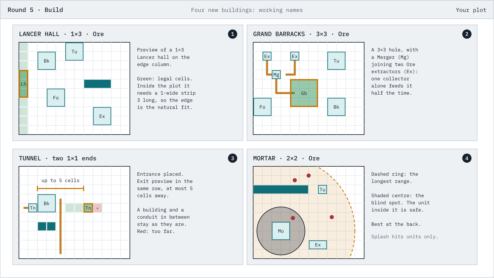

1. Lancer hall (1×3, from round 2). The green column along the plot edge is a legal spot; inside the plot it needs a free strip 1 wide and 3 long.
2. Grand barracks (3×3, from round 5). It needs a 3×3 hole, and a Merger (Mg) joins two Ore extractors to feed it (CB-10f).
3. Tunnel (two 1×1 ends, from round 3). The entrance is placed; the exit preview must be in a straight line, at most 5 cells away (CB-9g). Buildings and conduits in between stay where they are. A farther cell is red.
4. Mortar (2×2, from round 3). The dashed ring is its longest range; the shaded middle is the blind spot where it cannot shoot (CB-18b).

## 5. Main menu

Where a run starts or resumes. Saved runs are listed without limit. The host of a run holds its save; guests see the run as a pointer to the host.

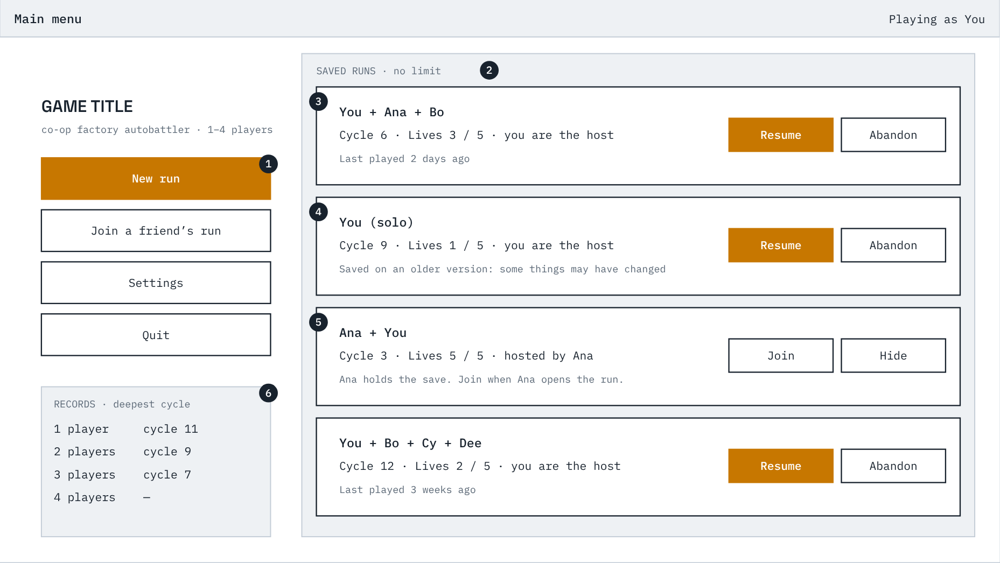

1. New run starts a lobby (or goes straight in, solo). Join enters a run a friend is hosting.
2. Saved runs. There is no limit, and each run appears once.
3. A run you host: you can resume it, or abandon it for the whole party.
4. A save from an older version says so before you resume: some things may have changed.
5. A run someone else hosts. They hold the save, so you can only join when they open it. Hide removes it from your list without ending it.
6. Records: the deepest round reached, kept per party size. Nothing else carries over between runs.

## 5b. Specialist pick

The first step of a run after the map is shown, before Core placement (RS-13, issue #469). Every player picks one specialist, solo too. Duplicates are allowed and there is no skip. Names, numbers and effects are placeholders.

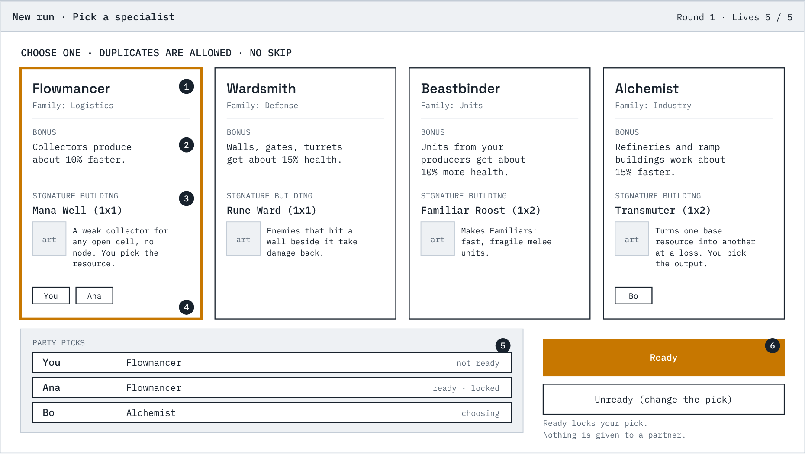

1. Four cards: the whole roster is always open. Each shows the specialist's name and family.
2. The family bonus: small, owner only, no downside (CB-51a).
3. The signature building: its name, footprint and what it does. Only this specialist can buy it, from round 2, in its own shop (EC-3b).
4. Your pick, highlighted. You can change it until you are Ready.
5. Every party member's current pick, visible as soon as it is made (RS-13b). Two players may pick the same specialist.
6. Ready needs a pick; a refused Ready says why. Ready locks your pick and Unready reopens it. The step ends when everyone is Ready; solo, when you are (RS-13c). On the later screens your specialist stays in the run bar.

## 5c. Sound settings

A small panel with three volume sliders and a mute switch (AU-23, `../specs/08-audio.md`, issue #446). It opens from the main menu and from the in-run Menu, with the same contents, and changes apply at once. The settings are kept per browser and are not part of a run. Levels are placeholders.

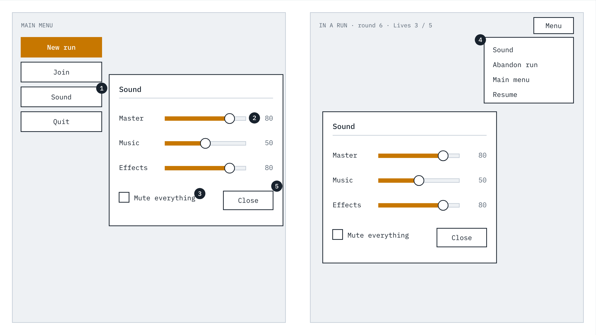

1. Main menu: the Sound button opens the panel over the menu.
2. Master scales Music and Effects. Each slider shows its level, 0 to 100.
3. Mute silences everything and keeps the levels. A muted game shows it on the Sound button.
4. In-run Menu: the same panel, opened from the run bar's Menu button. It never pauses or changes the run.
5. Close returns to the screen. A short click plays when a slider is released, so the level can be heard.

## 6. Core placement

The first decision of a run. The whole map is shown, and every player chooses where their own Core goes, in their own plot. A Core cannot be moved once everyone is ready. Other plots are dimmed. The image shows your own plot with the legal spots in green, your chosen spot and its enemy routes, a partner's dimmed plot, and the acting-player switcher in the run bar.

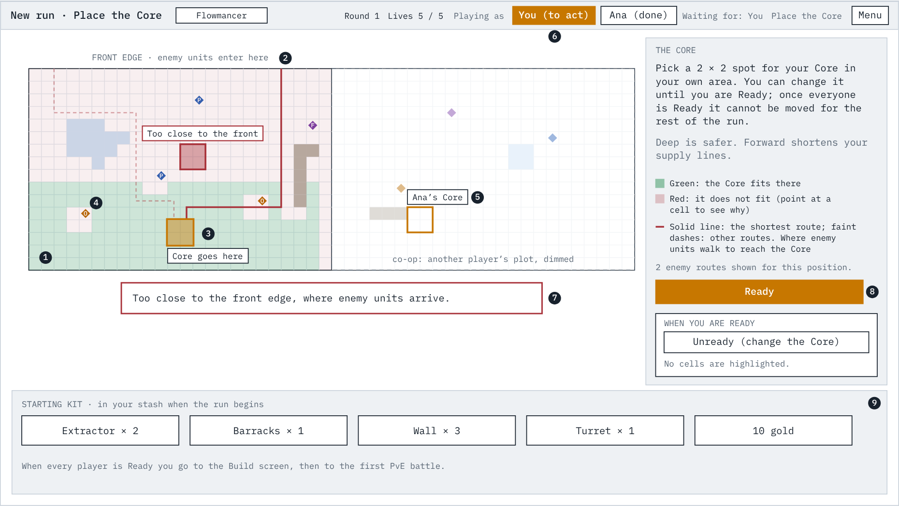

1. The whole map, visible and buildable from the start. It never expands.
2. The front edge, where enemy units will enter.
3. Your chosen Core position, marked "Core goes here", with the routes enemy units would take to reach it (the shortest solid, the others faint). You can change it until the step ends: while you are not ready, or after un-readying. Clicking the chosen cell again changes nothing.
4. Resource nodes. Where the rare one sits is a big part of the choice.
5. Another player's plot, dimmed, with their chosen spot outlined and named.
6. The acting-player switcher in the run bar, for playing every seat from one device (debug; two or more players): "(to act)" or "(done)" per player, and who is still awaited.
7. The reason line: why a red cell does not fit, or why a click or Ready was refused. It stays until the pointer moves to another cell or the acting player changes.
8. Ready needs a chosen spot and is per player. A Ready player is offered no spots and sees "Unready (change the Core)". In co-op every player places their own Core and readies up; there is no vote. The step ends when everyone has placed a Core and is ready. Solo just confirms.
9. The starting kit, waiting in the stash for the first build.

## 7. PvE difficulty choice

Before each PvE battle the party picks easy, medium, or hard. Each option shows what kind of enemy it is and what it pays.

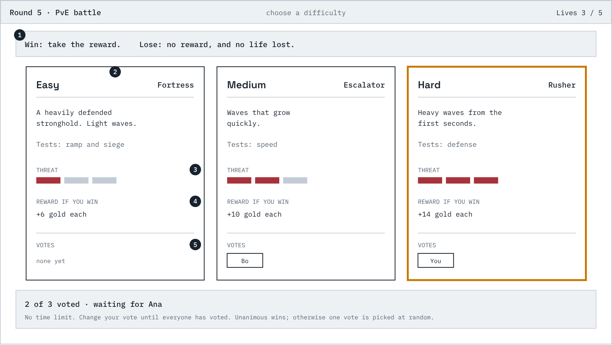

1. The stakes: losing a PvE battle costs no life, only the reward.
2. Difficulty and enemy type. The type tells you what the battle will test.
3. How strong the threat is.
4. What winning pays. Harder options pay more.
5. Votes. No time limit; you can change yours until the last player has voted, and then the battle starts.

## 8. Battle summary

Shown when playback ends. It says what happened and why, so the party can decide what to change.

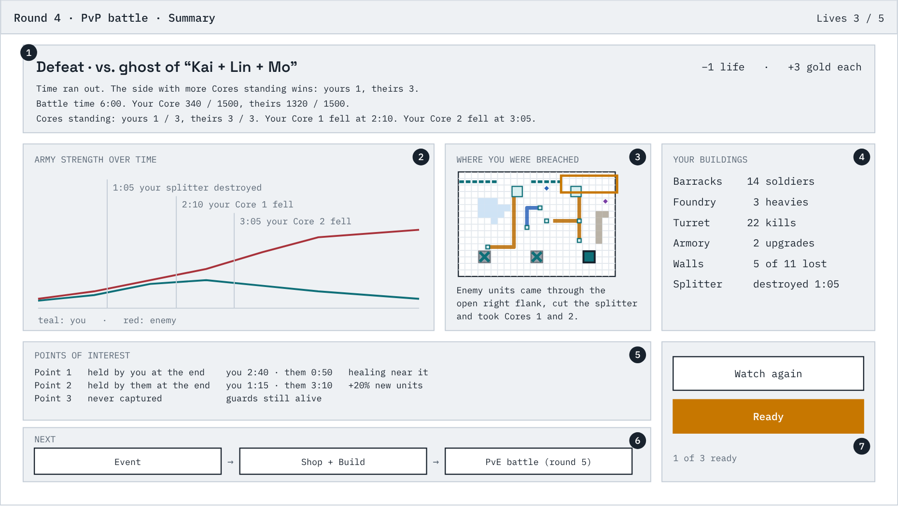

1. The result, and in the corner what it cost or paid: lives lost and gold gained. Battle rewards are always gold. Below it, why the battle ended, naming the step of the tiebreak ladder that decided it (at the time limit: more Cores standing, then the larger share of total Core health left), the Core health left on each side, how many Cores stand on each side and when each Core fell. The image shows a lost battle decided by Cores standing (1 against 3). A solo battle has one Core per side, so the Cores-standing line is left out.
2. Army strength over the battle for both sides, with the moments that mattered marked, including each Core that fell.
3. Where the enemy got through. Fallen Cores are greyed with a cross.
4. What each building did.
5. One line per point of interest: who held it at the end, how long each side held it, and its buff. It is not part of the tiebreak (PP-10).
6. What comes next in the round.
7. Watch the battle again, or ready up. The party moves on to the event when everyone is ready.

## 9. Run over

Every run ends in defeat; this screen says how far it got. An abandoned run ends here too.

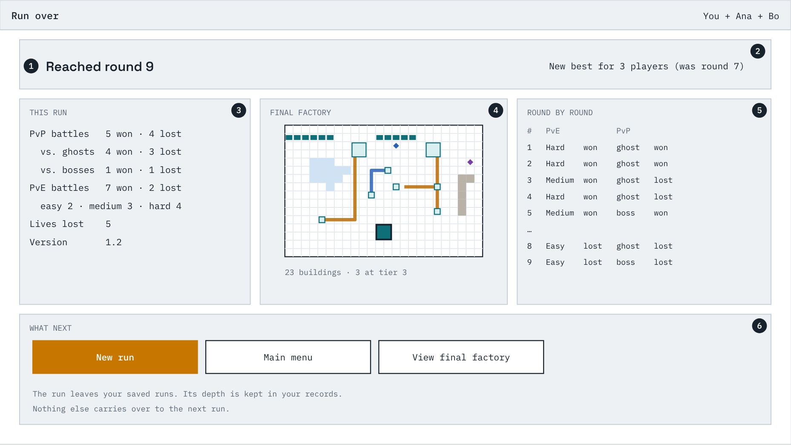

1. Depth reached, the score of the run.
2. Whether it beat the party's previous best for this party size.
3. Battle records for the run.
4. The factory as it stood at the end.
5. What was fought each round and how it went.
6. Start again or go back to the menu. The run leaves the saved list; its depth and history go into your records.
