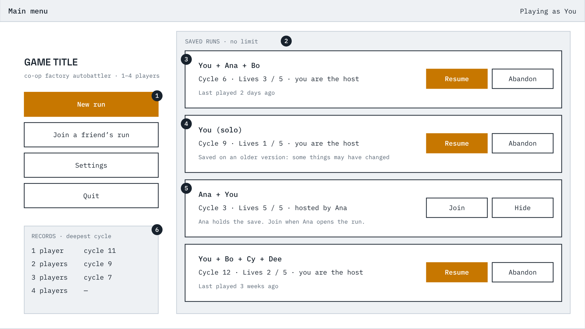
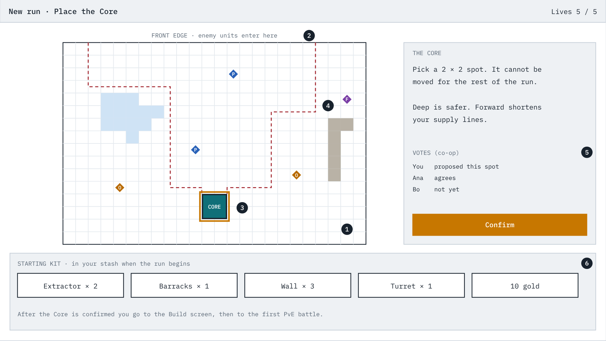
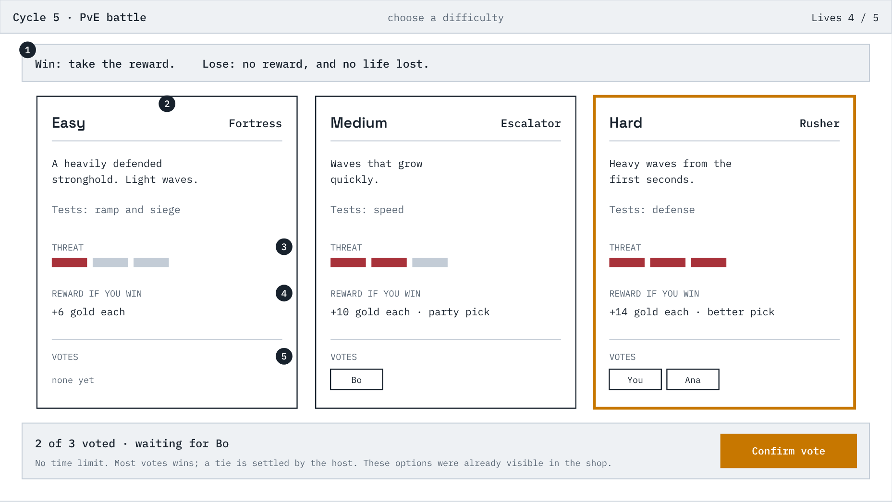
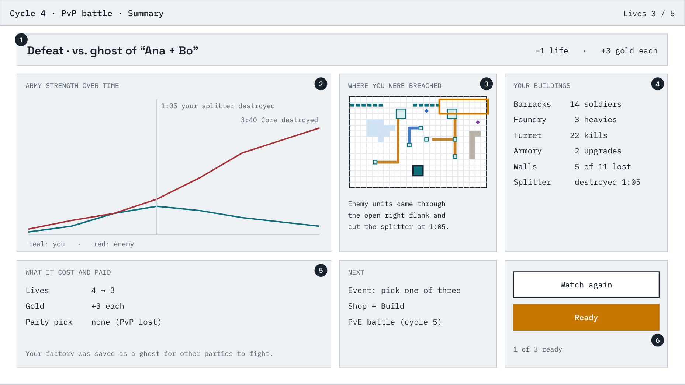
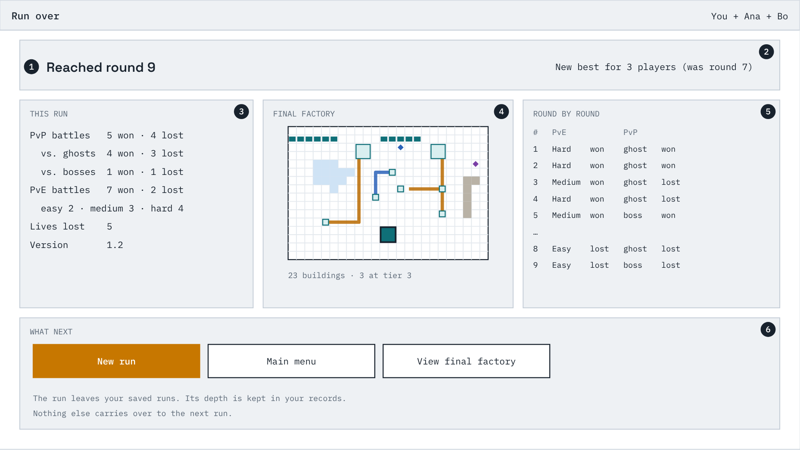

# Screen wireframes

Layout sketches for the screens of a run, drawn for a 1920×1080 screen with
the party's base at the bottom and the enemy at the top
(`../specs/03-combat.md` CB-45 to CB-48). They show what is on each screen
and where. Sizes, numbers, and building names are placeholders, and the
sketches show a solo view with co-op elements marked.

Specific numbers and example effects in the sketches — gold amounts, the
starting kit, threat pips, "an even chance to double it", "overload begins
4:00", player and ghost names — are placeholders, not rules.

The specs are the source of truth. Where a wireframe and a spec disagree,
the spec wins and the wireframe should be corrected.

**The images predate the per-player design (issue #124).** They still show
one shared board, one Core per side and a vote on the Core position. The text below has been updated to the current design
(each player has their own plot and Core, builds only there, and can link to
a neighbour across the plot border; there is no giving); the images and
`screens.html` are redrawn with the screens themselves.

Order in a run: 5 main menu → 6 Core placement → 4 build → then each round:
7 PvE choice → 1 battle → 8 summary → 2 event → 3 shop + 4 build → PvP
battle (1, 8) → 2 event → 3 shop + 4 build → … → 9 run over.

- `screens.html` — all the wireframes on one page, with the callouts. Open
  it in a browser. The screens are drawn by a script in the page, so edit
  that script to change them, then re-export the images.
- `1-battle.png` to `9-run-over.png` — the same screens as images.

Not drawn: the lobby for forming a party, settings, and the screens for the
deferred features (refining, points of interest).

Map legend: **Ex** extractor, **Bk** barracks, **Fo** foundry, **Tu** turret,
**Sp** splitter, **Ar** armory (an economy building), solid blocks are
walls, and **O / P / F** diamonds are Ore, Power, and Flux nodes. Conduits
are coloured by resource.

## 1. Battle

Nobody gives orders here. The party watches its factory start cold, ramp up, and send units across the neutral zone while the enemy does the same.

1. Who you are fighting and what kind of battle it is. A ghost shows the other party's names; a boss says so.
2. Your board, at the bottom, exactly as you built it. Conduits light up as resources flow.
3. The neutral zone. Its lakes and cliffs are generated for this battle and revealed when it starts. Nothing can be built here. Turrets can shoot enemy units in it; otherwise only units fight here.
4. The enemy board, at the top. Your units attack buildings in their way and finally the enemy Cores: first the one opposite their owner's plot, then the nearest still standing.
5. Units from both sides meet and form a front line.
6. The health of every Core on your side, one bar per player, and how many walls still stand. The enemy's is in the matching panel on the right. A side loses when all of its Cores are destroyed. (The image shows one Core bar per side; it is to be redrawn.)
7. Live production and army counts, so you can see the ramp.
8. Army strength over time for both sides. Useful afterwards for seeing when you fell behind.
9. Speed controls. In co-op, a change applies once everyone agrees.
10. A log of the moments that mattered, such as a junction being destroyed.
11. Camera. It starts at the center of the map, and the view pans and zooms, so a larger map or a four-player battle still works on the same screen.

## 2. Event choice

After every battle the party picks one of up to three events. It opens with the battle result so the reward is seen before the next decision.

1. Result of the battle just fought and what it paid.
2. Up to three offered events (never two of the same type). Each says exactly what it does before you choose.
3. Votes from each player. The highlighted card is your own vote; you can change it until the last player has voted.
4. Who has voted and how a split vote is settled (one vote is picked at random). There is no time limit; the event resolves once everyone has voted.

## 3. Shop

The shop always follows the event. Each player has their own offers and their own gold. Shop and Build are two tabs of the same step, so you can buy, place, and come back. Nothing is timed: the party moves on when every player has pressed Ready.

1. Tabs for the two halves of this step.
2. Your offers. A card shows the kind, what it needs (which resource and how much per second), what it does, and its price.
3. Gold buys buildings and re-rolls, nothing else.
4. Your stash: buildings you own that are not on the board. Drag here to sell.
5. Teammates' gold and stash. You do not see their offers, and gold and buildings cannot be given (CP-29). Hidden in solo.
6. What comes next. PvE options are shown ahead of time; a PvP opponent never is.
7. A small live view of the board that jumps to the Build tab.
8. Ready is available on both tabs.

## 4. Build

Where the factory is laid out. Everything of yours except your Core can be moved, and conduits are free. In co-op every player edits at the same time, each in their own plot; the other plots are shown but cannot be edited. (The image shows the earlier design, one shared board with one Core; it is to be redrawn.)

1. Stash. Drag a building into your own plot to place it; placing is free.
2. Tools. Conduit is always available and unlimited. Rotate turns the selected building. Undo covers layout changes only, never buying, selling, or re-rolling.
3. The board. Lakes and cliffs cannot be built on. Extractors only go on resource nodes.
4. Conduits, one resource each, coloured by resource. They cannot cross; the splitter is what lets one line feed two buildings. A conduit drawn to the border of a neighbour's plot joins the neighbour's conduit at the same spot into a border link; either player can remove their own half.
5. Your Core. Placed once at the start of the run; it has no move handle. Every player has one.
6. The front edge, along the top. Enemy units enter along it.
7. Preview of the routes enemy units would take with this layout, each to the Core of the plot it enters.
8. Inspector for the selected building: what it needs per second, what it is getting, what it produces. For a collector: its flow rate.
9. Overlays and problems: a dry run of resource flow, the enemy-path preview, and anything unconnected.
10. Party panel: who is editing where, pings, and the Ready button. The party moves on when everyone is ready.
11. In co-op each extra player adds a plot of their own to the side. A four-player board still fits the width of a 1080p screen, and everything below the board stays free for panels.

## 5. Main menu

Where a run starts or resumes. Saved runs are listed without limit. The host of a run holds its save; guests see the run as a pointer to the host.

1. New run starts a lobby (or goes straight in, solo). Join enters a run a friend is hosting.
2. Saved runs. There is no limit, and each run appears once.
3. A run you host: you can resume it, or abandon it for the whole party.
4. A save from an older version says so before you resume: some things may have changed.
5. A run someone else hosts. They hold the save, so you can only join when they open it. Hide removes it from your list without ending it.
6. Records: the deepest round reached, kept per party size. Nothing else carries over between runs.

## 6. Core placement

The first decision of a run. The whole map is shown, and every player chooses where their own Core goes, in their own plot. A Core cannot be moved afterwards. (The image shows the earlier design, one Core chosen by vote; it is to be redrawn.)

1. The whole map, visible and buildable from the start. It never expands.
2. The front edge, where enemy units will enter.
3. Your chosen Core position, with the routes enemy units would take to reach it. You can change it until the step ends: while you are not ready, or after un-readying.
4. Resource nodes. Where the rare one sits is a big part of the choice.
5. In co-op every player places their own Core and readies up; there is no vote. The step ends when everyone has placed a Core and is ready. Solo just confirms.
6. The starting kit, waiting in the stash for the first build.

## 7. PvE difficulty choice

Before each PvE battle the party picks easy, medium, or hard. Each option shows what kind of enemy it is and what it pays.

1. The stakes: losing a PvE battle costs no life, only the reward.
2. Difficulty and enemy type. The type tells you what the battle will test.
3. How strong the threat is.
4. What winning pays. Harder options pay more.
5. Votes. No time limit; you can change yours until the last player has voted, and then the battle starts.

## 8. Battle summary

Shown when playback ends. It says what happened and why, so the party can decide what to change.

1. The result, and in the corner what it cost or paid: lives lost and gold gained. Battle rewards are always gold.
2. Army strength over the battle for both sides, with the moments that mattered marked.
3. Where the enemy got through.
4. What each building did.
5. What comes next in the round.
6. Watch the battle again, or ready up. The party moves on to the event when everyone is ready.

## 9. Run over

Every run ends in defeat; this screen says how far it got. An abandoned run ends here too.

1. Depth reached, the score of the run.
2. Whether it beat the party's previous best for this party size.
3. Battle records for the run.
4. The factory as it stood at the end.
5. What was fought each round and how it went.
6. Start again or go back to the menu. The run leaves the saved list; its depth and history go into your records.
