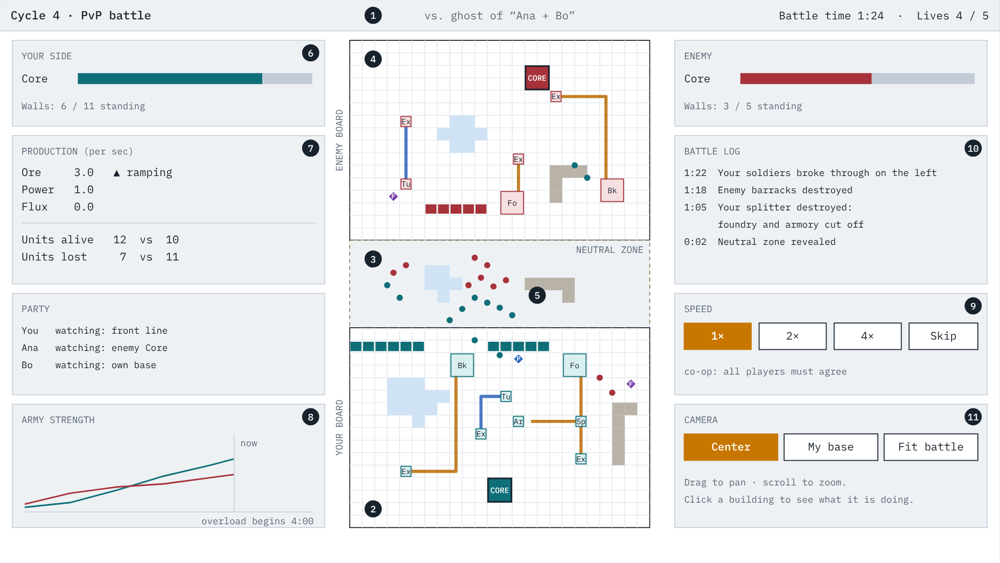
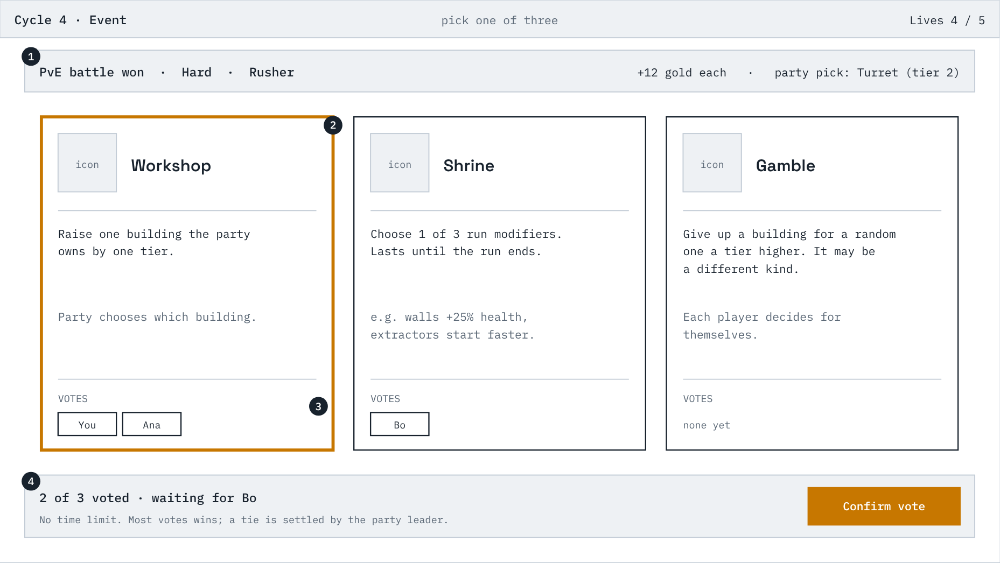
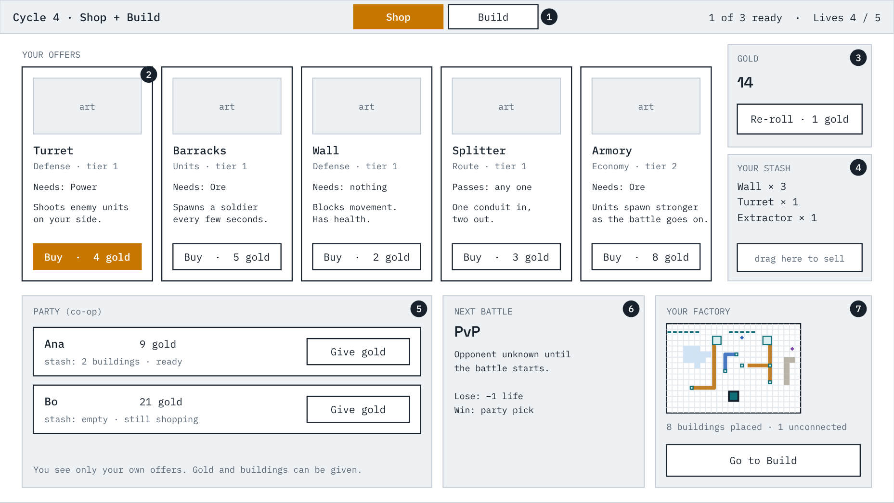
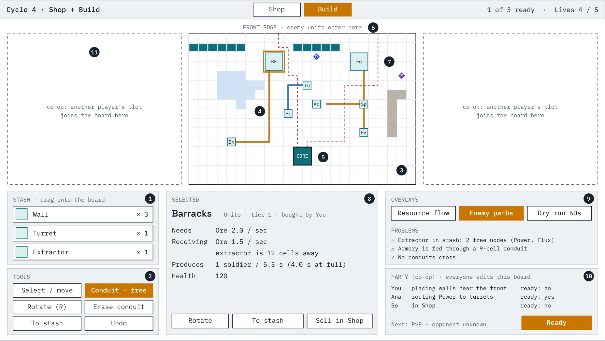

# Screen wireframes

Layout sketches for the four screens of one cycle, drawn for a 1920×1080
screen with the party's base at the bottom and the enemy at the top
(`../specs/03-combat.md` CB-45 to CB-48). They show what is on each screen
and where. Sizes, numbers, and building names are placeholders, and the
sketches show a solo view with co-op elements marked.

The specs are the source of truth. Where a wireframe and a spec disagree,
the spec wins and the wireframe should be corrected.

- `screens.html` — all four wireframes on one page, with the callouts. Open
  it in a browser. The screens are drawn by a script in the page, so edit
  that script to change them, then re-export the images.
- `1-battle.png` to `4-build.png` — the same screens as images.

Map legend: **Ex** extractor, **Bk** barracks, **Fo** foundry, **Tu** turret,
**Sp** splitter, **Ar** armory (an economy building), solid blocks are
walls, and **O / P / F** diamonds are Ore, Power, and Flux nodes. Conduits
are coloured by resource.

## 1. Battle

Nobody gives orders here. The party watches its factory start cold, ramp up, and send units across the neutral zone while the enemy does the same.

1. Who you are fighting and what kind of battle it is. A ghost shows the other party's names; a boss says so.
2. Your board, at the bottom, exactly as you built it. Conduits light up as resources flow.
3. The neutral zone. Its lakes and cliffs are generated for this battle and revealed when it starts. Buildings do nothing here; only units fight.
4. The enemy board, at the top. Your units attack buildings in their way and finally the Core.
5. Units from both sides meet and form a front line.
6. Your Core's health and how many walls still stand. The enemy's is in the matching panel on the right.
7. Live production and army counts, so you can see the ramp.
8. Army strength over time for both sides. Useful afterwards for seeing when you fell behind.
9. Speed controls. In co-op, a change applies once everyone agrees.
10. A log of the moments that mattered, such as a junction being destroyed.
11. Camera. It starts at the center of the map, and the view pans and zooms, so a larger map or a four-player battle still works on the same screen.

## 2. Event choice

After every battle the party picks one of three events. It opens with the battle result so the reward is seen before the next decision.

1. Result of the battle just fought and what it paid.
2. Three offered events. Each says exactly what it does before you choose.
3. Votes from each player. The highlighted card is currently winning.
4. Who has voted and how ties are settled. There is no time limit; the event resolves once everyone has voted.

## 3. Shop

The shop always follows the event. Each player has their own offers and their own gold. Shop and Build are two tabs of the same step, so you can buy, place, and come back. Nothing is timed: the party moves on when every player has pressed Ready.

1. Tabs for the two halves of this step.
2. Your offers. A card shows the kind, what it needs, what it does, and its price.
3. Gold buys buildings and re-rolls, nothing else.
4. Your stash: buildings you own that are not on the board. Drag here to sell.
5. Teammates' gold and stash, with a way to give gold. You do not see their offers. Hidden in solo.
6. What comes next. PvE options are shown ahead of time; a PvP opponent never is.
7. A small live view of the board that jumps to the Build tab.

## 4. Build

Where the factory is laid out. Everything except the Core can be moved, and conduits are free. In co-op every player edits this same board at once.

1. Stash. Drag a building onto the board to place it; placing is free.
2. Tools. Conduit is always available and unlimited. Rotate turns the selected building.
3. The board. Lakes and cliffs cannot be built on. Extractors only go on resource nodes.
4. Conduits, one resource each, coloured by resource. They cannot cross; the splitter is what lets one line feed two buildings.
5. The Core. Placed once at the start of the run; it has no move handle.
6. The front edge, along the top. Enemy units enter along it.
7. Preview of the routes enemy units would take to the Core with this layout.
8. Inspector for the selected building: what it needs, what it is getting, what it produces.
9. Overlays and problems: a dry run of resource flow, the enemy-path preview, and anything unconnected.
10. Party panel: who is editing where, pings, and the Ready button. The battle starts when everyone is ready.
11. In co-op each extra player adds a plot to the side. A four-player board still fits the width of a 1080p screen, and everything below the board stays free for panels.
